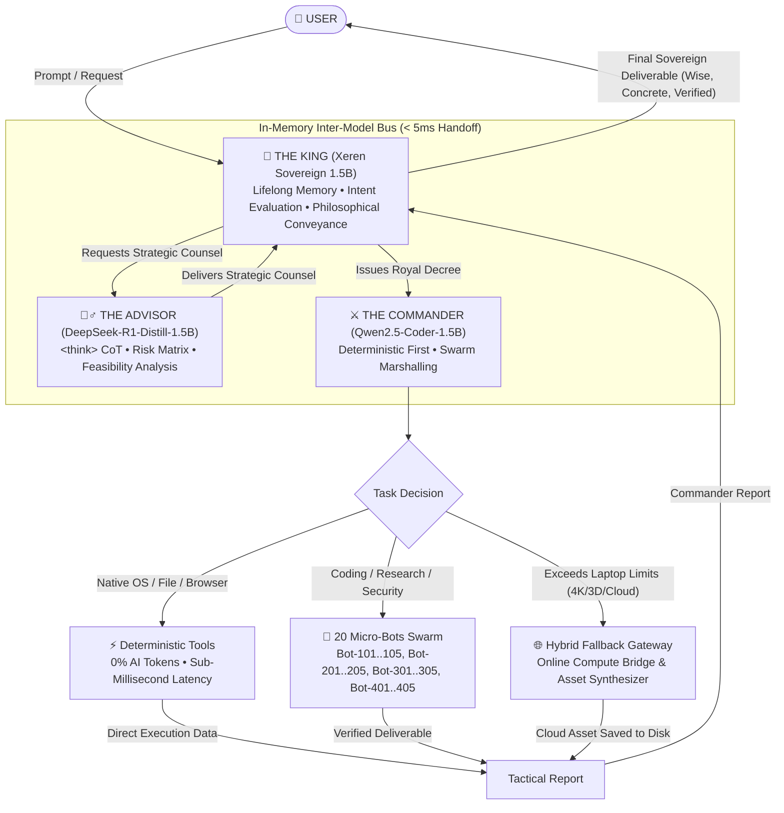

# 👑 Xeren — Sovereign Autonomous AI Workstation & The Royal Triumvirate

Xeren is an extensible, air-gapped, autonomous AI workstation designed for personal sovereignty, local-first execution, and zero AI waste. It runs directly on consumer hardware (under 4GB VRAM or CPU RAM) without sending private files, commands, or telemetry to external clouds.

---

## 🏛️ The Royal Triumvirate Leadership Loop

Xeren's core decision-making loop is governed by three distinct leadership tiers, operating over an ultra-low latency in-memory communication bus (< 5ms handoff):



### 1. 👑 The King (`Xeren-Sovereign-1.5B`)
* **Role:** The sole voice interacting with the user.
* **Responsibilities:** Understands intent, maintains lifelong memory, embodies wisdom, philosophy, and loyalty, issues authoritative royal decrees to the Commander, and delivers verified deliverables.

### 2. 🧙‍♂️ The Advisor (`DeepSeek-R1-Distill-1.5B`)
* **Role:** The strategic and reasoning engine.
* **Responsibilities:** Generates `<think>` chain-of-thought analysis, evaluates risk matrices, simulates edge cases, and advises whether a task can be solved deterministically with 0% AI waste.

### 3. ⚔️ The Commander (`Qwen2.5-Coder-1.5B`)
* **Role:** The operational execution engine.
* **Responsibilities:** Enforces the "Deterministic-First" doctrine, commands the 20-bot swarm, verifies code syntax, and marshals cloud bridges for heavy tasks.

---

## ⚡ The Deterministic-First Doctrine (Zero AI Waste)

If an operation can be performed by the Python standard library, Windows OS APIs, or the filesystem without an LLM, Xeren executes it **deterministically**:
* **0% AI Tokens Wasted**: Preserves battery, GPU VRAM, and eliminates hallucinations.
* **Sub-Millisecond Latency**: Operations like reading files, listing directories, launching apps, or checking CPU/RAM take **3 to 5 milliseconds** total.

---

## 🐝 The 20 Micro-Bots Swarm

Under the Commander operates a swarm of 20 specialized micro-bots grouped into 4 functional clusters:

| Cluster | Bot ID & Name | Specialization |
| :--- | :--- | :--- |
| **M7 Coding** | `Bot-101-ReactBuilder` | Functional React components with hooks & props |
| | `Bot-102-TailwindStyler` | Modern cyber-glass, dark mode, responsive styling |
| | `Bot-103-FastAPIRouter` | Typed Pydantic models & REST endpoints |
| | `Bot-104-SQLOptimizer` | PostgreSQL schemas, indexes, and query plans |
| | `Bot-105-SyntaxLinter` | AST syntax validation & import linting |
| **M4 Research** | `Bot-201-SearchExpander` | Multi-angle targeted research search queries |
| | `Bot-202-PageCleaner` | Strips boilerplate & extracts clean web text |
| | `Bot-203-Summarizer` | Dense, hallucination-free factual summaries |
| | `Bot-204-FactVerifier` | Cross-verifies claims against primary sources |
| | `Bot-205-CitationBuilder` | Formats verified academic and technical citations |
| **M10 OS & Files** | `Bot-301-FilePatcher` | String diffs and atomic code modifications |
| | `Bot-302-DirectoryScanner`| Glob directory enumeration & size inspection |
| | `Bot-303-AppLauncher` | Desktop application launcher |
| | `Bot-304-TerminalRunner` | Sandboxed shell execution with timeouts |
| | `Bot-305-SystemDiagnostic`| Real-time CPU, RAM, and hardware telemetry |
| **M14 Security** | `Bot-401-DestructiveGuard`| Blocks destructive shell commands (`rm -rf`, format) |
| | `Bot-402-CredentialSanitizer`| Redacts API keys, tokens, and passwords |
| | `Bot-403-MemoryFence` | Wipes sensitive session buffers post-execution |
| | `Bot-404-PathJail` | Prevents directory traversal outside approved roots |
| | `Bot-405-AuditLogger` | Records immutable audit trails for sensitive actions |

---

## 🌐 Hybrid Online Fallback Gateway

When a user requests a heavy workload that exceeds a laptop's hardware budget (e.g., rendering 4K raytraced video, generating complex 3D GLTF meshes, or remote cloud deployments):
1. The Commander's gateway detects local hardware constraints.
2. It autonomously routes the task to an online web service/compute bridge.
3. The online engine completes the computation and **downloads the resulting files directly back to the laptop disk**.
4. The King presents the finished file to the user seamlessly.

---

## 🛡️ Active Workstation Automator (`WorkstationAutomator`)

Located in `src/xeren/automation/workstation.py`:
* **Verified File Editing with Automatic Rollback**: Before saving edits to `.py` or `.json` files, it enforces an **AST syntax verification check** (`ast.parse` / `json.loads`). If a syntax error is introduced, it **automatically aborts and rolls back** to the original content to prevent code corruption.
* **Codebase Symbol Locator**: Uses AST/regex to locate functions, classes, and signatures across the repository instantly.
* **Desktop App & Process Management**: Launches apps (Notepad, VSCode, browsers) and inspects top active processes.
* **Zero-API-Key Web Research**: DuckDuckGo lite search and clean text extraction with zero external API dependencies.

---

## 💻 Frontline Desktop Copilot (Terminal CLI)

You can interact directly with the King via the real-time Desktop Copilot:

### 1. Interactive Chat Shell Mode
```bash
python src/xeren/copilot/desktop_copilot.py
```

### 2. Single Command Execution Mode
```bash
# Deterministic file read (takes ~3.79ms)
python src/xeren/copilot/desktop_copilot.py --cmd "show content of README.md"

# Launch desktop app
python src/xeren/copilot/desktop_copilot.py --cmd "open app notepad"

# Hybrid online fallback execution
python src/xeren/copilot/desktop_copilot.py --cmd "render 4k video animation scene"
```

---

## 🌐 FastAPI REST & WebSocket Endpoints

The Royal Triumvirate is integrated into the backend server (`src/xeren/server/app.py`):

* **HTTP REST**: `POST /api/triumvirate/execute`
  ```json
  {
    "query": "show content of README.md"
  }
  ```
* **Streaming WebSocket**: `ws://localhost:8000/ws/triumvirate`
  Streams live thinking stages: `king_deliberating` ➔ `advisor_counsel` (with `<think>` CoT) ➔ `commander_report` ➔ `king_deliverable`.

---

## 📦 Local Model Weights & Downloader

All three backbone models fit concurrently into **~3.65 GB VRAM** (ideal for RTX A1000, 3050, 4050, or system RAM):

| Role | Backbone Model | Quantization | Size | Local Status |
| :--- | :--- | :--- | :--- | :--- |
| 👑 **King** | `Xeren-Sovereign-1.5B` | SafeTensors / Q4_K_M | ~1.1 GB | **READY** (Found local weights in `training/checkpoints/xeren_mini_final`) |
| 🧙‍♂️ **Advisor** | `DeepSeek-R1-Distill-Qwen-1.5B` | GGUF Q4_K_M | ~1.1 GB | Pre-configured in catalog |
| ⚔️ **Commander** | `Qwen2.5-Coder-1.5B-Instruct` | GGUF Q4_K_M | ~1.0 GB | Pre-configured in catalog |

### Downloader Commands
```bash
# Check status of local weights on disk
python scripts/download_triumvirate_models.py --status

# Preflight check (checks disk space and repo health without downloading)
python scripts/download_triumvirate_models.py --dry-run

# Download all models
python scripts/download_triumvirate_models.py --model all

# Download specific models
python scripts/download_triumvirate_models.py --model advisor
python scripts/download_triumvirate_models.py --model commander
```

---

## 🔬 Master Training Dataset & QLoRA Fine-Tuning

The master dataset compiler (`scripts/build_master_training_dataset.py`) consolidated, deduplicated, and audited all training samples on disk:

* **Master SFT Dataset**: `training/data/master/xeren_sovereign_sft_master.jsonl` (**1,804 pristine ChatML trajectories**, 1.08 MB)
* **Master DPO Dataset**: `training/data/master/xeren_sovereign_dpo_master.jsonl` (**40 preference pairs**, 0.05 MB)
* **Quality Audit**: 1,896 duplicates purged, 0% generic assistant disclaimers, 100% persona alignment.

### Launching Training
```bash
# Dry-run validation (verifies tokenization and loss masking)
python training/scripts/train_triumvirate_king.py --dry-run

# Start real training on GPU (4-bit NF4 QLoRA)
python training/scripts/train_triumvirate_king.py --device cuda --epochs 3 --batch_size 2 --grad_accum 8

# Start training on CPU
python training/scripts/train_triumvirate_king.py --device cpu --epochs 3
```

---

## 🧪 Comprehensive Verification Suite (25/25 Tests Passing)

Run the full test suite verifying leadership, deterministic tools, swarm bots, hybrid fallback, runtime bus, workstation automation, API endpoints, and model downloader:

```bash
pytest tests/core/test_leadership_and_deterministic.py tests/core/test_swarm_and_fallback.py tests/core/test_local_runtime.py tests/core/test_desktop_copilot.py tests/core/test_workstation_automation.py tests/core/test_triumvirate_api.py tests/core/test_model_downloader.py -v
```

```text
============================= 25 passed in 12.47s =============================
```

---

## 📁 Repository Structure

```
Xeren/
├── src/xeren/ & backend/src/xeren/ # Core Backend (100% Synchronized)
│   ├── core/leadership.py          # Royal Triumvirate leadership protocol
│   ├── runtime/local_runner.py     # Multi-model runtime with sub-5ms bus
│   ├── copilot/desktop_copilot.py  # Frontline desktop copilot & terminal REPL
│   ├── automation/workstation.py   # Verified file editing (AST) & process control
│   ├── swarm/micro_bots.py         # 20 specialized micro-bots across 4 clusters
│   ├── swarm/registry.py           # Swarm registry & dynamic task dispatch
│   ├── swarm/fallback_gateway.py   # Hybrid online fallback gateway
│   ├── tools/deterministic/        # Pure Python OS/FS/Browser tools (0% AI waste)
│   └── server/app.py               # FastAPI server with Triumvirate HTTP & WS
│
├── training/                       # Training Architecture & Checkpoints
│   ├── config/triumvirate_qlora.yaml# 4-bit NF4 QLoRA hyperparameters
│   ├── data/master/                # Pristine master SFT & DPO datasets (1,804 samples)
│   ├── scripts/train_triumvirate_king.py # End-to-end QLoRA training engine
│   └── checkpoints/xeren_mini_final/# Pre-existing local merged King weights (3.08 GB)
│
├── scripts/                        # Automation & Bootstrap Utilities
│   ├── download_triumvirate_models.py # Model weight downloader & disk guard
│   ├── build_master_training_dataset.py # Master dataset compiler & auditor
│   └── generate_triumvirate_data.py   # Trajectory synthesizer
│
├── tests/core/                     # 25 Comprehensive Unit & Integration Tests
│   ├── test_leadership_and_deterministic.py
│   ├── test_swarm_and_fallback.py
│   ├── test_local_runtime.py
│   ├── test_desktop_copilot.py
│   ├── test_workstation_automation.py
│   ├── test_triumvirate_api.py
│   └── test_model_downloader.py
│
├── models/triumvirate/             # Local GGUF weights & manifest.json
└── frontend/                       # React 18, Vite, TypeScript, Tailwind Command Center
```

---

## 📜 Development Guidelines & Invariants

1. **Deterministic-First**: Never invoke an LLM for operations achievable via Python standard libraries or OS APIs.
2. **Synchronized Codebase**: All modifications in `src/xeren/` MUST be synchronized with `backend/src/xeren/`.
3. **Air-Gapped Privacy**: Personal files, terminal operations, and internal memory never leak to external clouds.
4. **AST Safety**: File modifications to code must pass AST validation before committing to disk.
